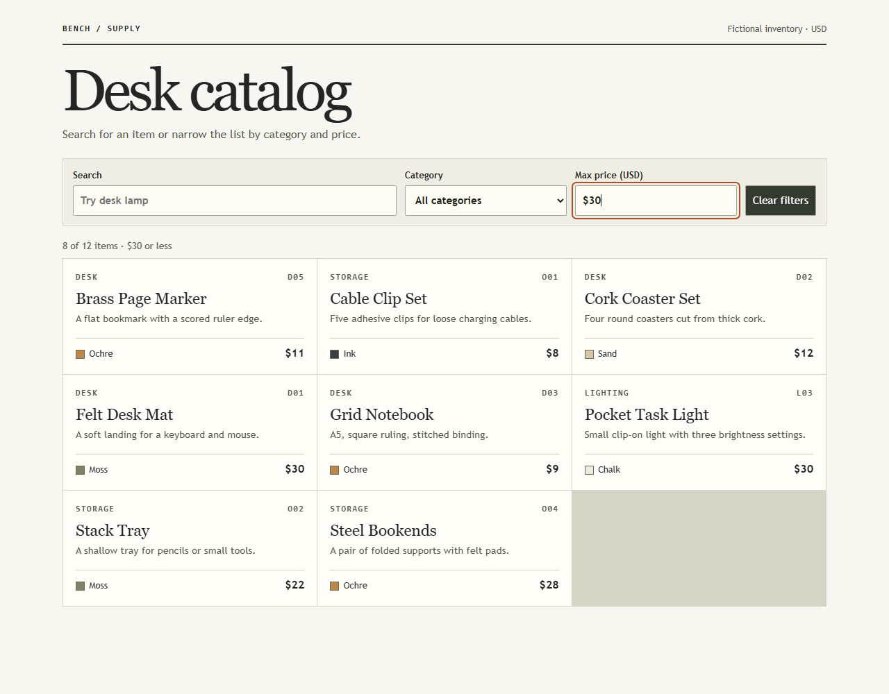

# Bench Supply catalog search

Open `index.html` in a browser. The catalog contains 12 fictional desk products. Search and filters work offline without a backend.



Try `desk lamq` to find Pivot Desk Lamp. Clear the query and set Max price to `$30` to see eight products. `29,99` shows six. The cap includes equal prices; blank removes it.

Search tolerates one inserted, missing or replaced letter in longer name tokens. It does not handle synonyms or swapped letters.

```sh
node --test search.test.cjs
```

*Built with AI assistance. Search uses plain JavaScript, not a model.*
